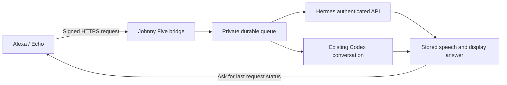

# Johnny Five

Ask Amazon Alexa to talk to your Hermes agent or Codex conversation, and receive
both a spoken answer and written detail on your Alexa device or in the Alexa app.

Johnny Five is a self-hosted Alexa custom skill. Hermes handles ordinary requests;
an explicit request routes to Codex. A durable queue lets the agent finish work
after Alexa's quick acknowledgment. Ask for your last request's status to retrieve
the result. Echo Show devices receive a scrollable APL screen; other devices
receive speech and an Alexa app card.



## Try saying

- “Alexa, open Johnny Five.”
- “Ask Hermes to recommend a recipe.”
- “Ask Codex to summarize our current project.”
- “Give me a house briefing.”
- “What is the status of my last request?”

Opening Johnny Five first is more reliable for longer requests. Recipe and house
briefing examples require the corresponding skills/data sources in your Hermes
agent; this repository does not include anyone's recipe PDFs or household data.

## Requirements

- Linux host, Python 3.10 or newer, and the pinned Python dependencies.
- An Amazon developer account associated with your Alexa devices.
- A publicly reachable HTTPS endpoint with a trusted certificate.
- Hermes with its authenticated API enabled, and/or an existing signed-in Codex
  session with `codex queue` and the managed app-server's private Unix socket.

Codex routing uses the installed desktop/CLI integration and may depend on the
Codex version. It does not launch a competing daemon or grant approval requests.
Configure an existing conversation ID; Hermes-only setup does not require one.

## Private configuration, outside the repository

Amazon developer usernames and passwords are **not required by the bridge**.
Sign into Amazon's developer console separately. The bridge needs only the
skill ID, an allowed Alexa account ID, and the selected backend connection.

```sh
python3 -m venv .venv
.venv/bin/python -m pip install -r requirements.lock
install -d -m 700 "$HOME/.config/johnny-five-alexa"
install -m 600 config.example.json "$HOME/.config/johnny-five-alexa/config.json"
```

Edit that private file locally:

| Setting | Purpose |
|---|---|
| `ALEXA_SKILL_ID` | Your Alexa custom skill's application ID |
| `ALEXA_USER_IDS` | Comma-separated allowed Alexa user IDs |
| `HERMES_URL` | Private authenticated Hermes API base URL |
| `HERMES_API_KEY` | Hermes API credential |
| `CODEX_THREAD_ID` | Existing Codex conversation ID; optional for Hermes-only use |
| `CODEX_BIN` | Codex executable path or `codex` on PATH |
| `STATE_DIR` | Optional private runtime directory |

The default config location is `~/.config/johnny-five-alexa/config.json`.
Set `JOHNNY_FIVE_CONFIG` to use another external path. On Linux, the file must be
owned by the running user with mode 600. Config inside the checkout is rejected.
Environment settings can override the supported fields for existing deployments.
Runtime data defaults to `~/.local/share/johnny-five-alexa`, outside the checkout.

Only the blank `config.example.json` belongs in Git. Never upload a filled copy,
runtime databases, authentication caches, private keys or conversation exports.

## Create the Alexa skill

1. In the [Alexa developer console](https://developer.amazon.com/alexa/console/ask),
   create a **Custom** skill named Johnny Five, language English (US), with
   **Provision your own** hosting and **Start from Scratch**.
2. Paste `interaction-model.json` into Build → Interaction Model → JSON Editor.
   Save and build. The invocation name is `johnny five`.
3. In Interfaces, enable **Alexa Presentation Language** for supported display
   profiles; save and rebuild. This enables the Echo Show screen response.
4. Copy the skill ID into your private config. Enable Development testing and
   obtain your Alexa user ID from the simulator's request JSON under
   `context.System.user.userId`; add it to `ALEXA_USER_IDS`. The simulator may
   use a different ID from another signed device session.
5. Configure the HTTPS endpoint as `https://YOUR_HOST/alexa`, using the trusted
   certificate authority option. Do not upload private configuration into the
   interaction model or publish authentication endpoints.

The bridge refuses to start without the two Alexa identity settings. It
validates Amazon request signatures, timestamps, skill ID and allowed user ID.
Unsigned HTTP requests are rejected. There is no unauthenticated enrollment
mode; use a signed simulator request to identify the account.

## Run

```sh
.venv/bin/python -m unittest -v
.venv/bin/python bridge.py
```

The bridge listens on `127.0.0.1:9120`, path `/alexa`. Put a trusted HTTPS reverse
proxy in front of it, or use [Tailscale Funnel](https://tailscale.com/kb/1223/funnel).
For Funnel, first save your existing publishing configuration, then publish
only this bridge with `tailscale funnel --bg --https=443 9120`. Use the HTTPS
hostname Tailscale reports as the Alexa endpoint. Preserve other listeners.
Never expose the Codex socket, Hermes API, configuration or runtime directory.

For a user service, clone/install this checkout at `~/johnny-five-alexa`, then:

```sh
install -d "$HOME/.config/systemd/user"
install -m 644 johnny-five.service "$HOME/.config/systemd/user/johnny-five.service"
systemctl --user daemon-reload
systemctl --user enable --now johnny-five.service
```

If you use another installation path, edit the service's WorkingDirectory and
ExecStart. Configure user lingering if your host needs the service to run without
an interactive login. No AWS hosting is required for this self-hosted approach.

## Spoken and written answers

The agent is asked for this response format:

```json
{
  "title": "Answer title",
  "speech": "A brief spoken summary.",
  "display": "The complete useful answer, including instructions and sources."
}
```

Plain-text answers remain supported. The bridge owns the APL template and escapes
model content; model output cannot inject Alexa directives. Responses have bounded
speech/card/screen sizes and explicitly mark shortened detail. Full model answers
remain in the backend. Slow jobs require a follow-up status request; this is not
an unsolicited push-notification system.

## Optional media addon

The included `addons/media-concierge/concierge.py` handles Plex, Radarr, Sonarr and
NZBGet media intents. Its credentials live separately in
`~/.local/share/media-concierge/config.json`; no configured file is included.
See [addon setup](addons/media-concierge/README.md). Without that configuration,
media requests report the connection as unavailable. Hermes/Codex requests work
independently. Existing download quality profiles and pause state are preserved.

## Operation and boundaries

An allowed Alexa account identifies the household, not an individual speaker.
Connected agents retain their existing permissions; prompt instructions are not
a technical read-only sandbox. Approval requests remain for review in Codex.
Do not start duplicate automation agents or actuate equipment merely to test.

The queue deduplicates Amazon request IDs. After a crash, an in-progress request
is marked uncertain and is not replayed automatically. Check the backend before
retrying consequential work. Runtime prompts/results remain in private local
state; HTTP logs omit prompts, headers and raw exception details.

To disable, stop/disable `johnny-five.service`, remove only this bridge's HTTPS
listener, and disable Development testing in Amazon. Preserve private state if
you need request history. The repository contains source and blank examples,
not a working account configuration.

## References

- [Amazon: host a custom skill as a web service](https://developer.amazon.com/en-US/docs/alexa/custom-skills/host-a-custom-skill-as-a-web-service.html)
- [Amazon: enable APL](https://developer.amazon.com/en-US/docs/alexa/alexa-presentation-language/apl-support-for-your-skill.html)
- [Hermes API server](https://hermes-agent.nousresearch.com/docs/user-guide/features/api-server)
- [Codex app-server](https://learn.chatgpt.com/docs/app-server)
